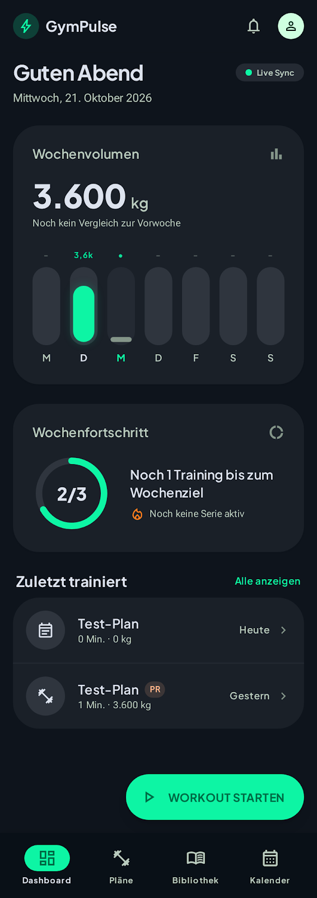
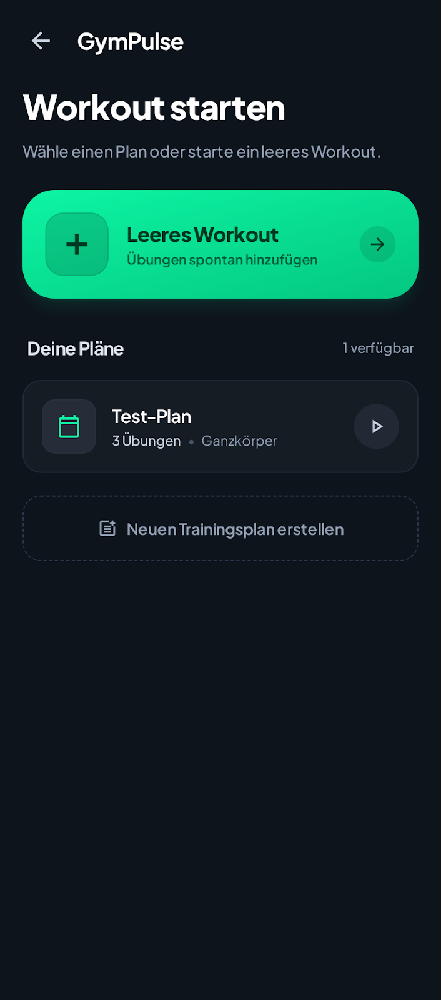
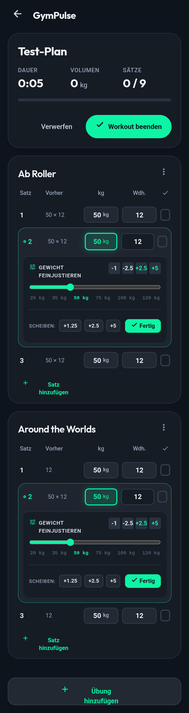
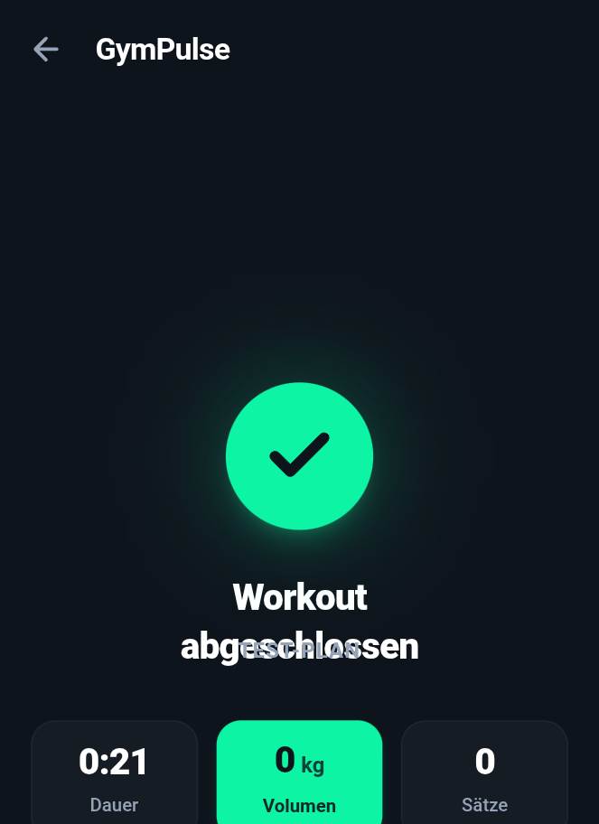
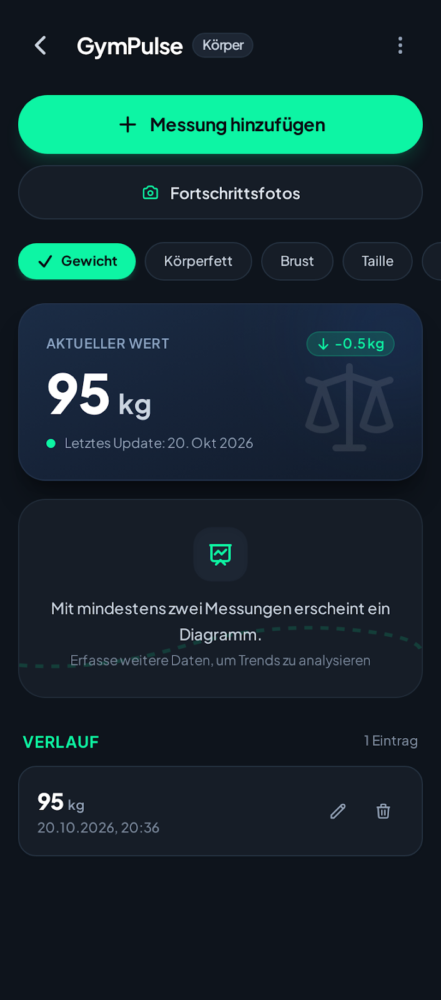
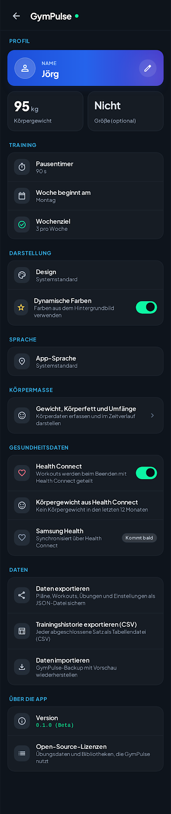

# GymPulse

Offline-first Gym- und Workout-Tracker für Android, mit Companion-App für Wear OS.
Alle Daten liegen lokal in einer Room-Datenbank auf dem Handy. Das Training läuft auch im Keller-Gym ohne Netz.
Health Connect, Cloud-Backup und der lokale KI-Coach sind optional und standardmäßig aus.

> Status: Version 0.1.0, Entwicklung läuft. Ein Play-Store-Eintrag gibt es noch nicht, installiert wird per APK (siehe [Installation](#installation)).

## Inhalt

- [Features](#features)
- [Screenshots](#screenshots)
- [Installation](#installation)
- [Wear OS](#wear-os)
- [Lokaler KI-Coach](#lokaler-ki-coach)
- [Cloud-Backup](#cloud-backup)
- [Export und Import](#export-und-import)
- [Tech-Stack](#tech-stack)
- [Architektur](#architektur)
- [Selbst bauen](#selbst-bauen)
- [Release und CI](#release-und-ci)
- [Roadmap](#roadmap)
- [Lizenzen und Datenquellen](#lizenzen-und-datenquellen)

## Features

**Training**
- Aktives Workout als Vollbild-Screen mit Satz-Tracking, vorbefüllten Werten aus der letzten Session ("Vorher"), Aufwärm-, Arbeits- und Dropsätzen, Notizen und Geräteeinstellungen pro Übung.
- Pausentimer, der den Prozesstod übersteht (`endsAt` liegt in DataStore). Autostart, Dauer und Vibration sind einstellbar.
- Workout beenden oder verwerfen, auch mit offenen Sätzen. Die Zusammenfassung zeigt Dauer, Volumen, Sätze und neue Bestleistungen (PRs).
- Volumenberechnung inklusive Körpergewichtsübungen (Körpergewicht × Faktor + Zusatzgewicht). Gewicht ist immer in kg.

**Pläne und Kalender**
- Trainingspläne mit Zielvorgaben (Sätze, Wiederholungsbereich, Zielgewicht, Pause) und optionalen Supersatz-Gruppen.
- Kalender mit Wochenschema, Ausnahmen für einzelne Tage, Wochen- und Monatsansicht und Trainingshistorie.

**Bibliothek**
- Mitgelieferte Übungsdatenbank (Basis free-exercise-db, deutsche Namen ergänzt) und Gerätevorlagen mit typischen Einstell-Schlüsseln, etwa Sitzhöhe oder Bolzenposition.
- Eigene Übungen und Geräte lassen sich jederzeit anlegen. Suche und Filter nach Muskelgruppe, Equipment und Favoriten.

**Auswertung**
- Dashboard mit Wochenvolumen, Wochenfortschritt, "Workout starten" und letzten Sessions.
- Klassische Trainingsauswertung ohne KI (`core:insights`): geschätztes 1RM, Trend, Progressionsvorschläge und Volumen, dargestellt als Insight-Karten.
- Körpermaße (Gewicht, Körperfett, Umfänge) mit Verlauf und Diagramm, Fortschrittsfotos nur lokal auf dem Gerät.

**Verbindungen (alle Opt-in)**
- Health Connect: Workouts schreiben, Körpergewicht, Herzfrequenz, Schritte und aktive Kalorien lesen, optional Schlaf. Samsung Health läuft ausschließlich über Health Connect.
- Google-Login und manuelles Cloud-Backup über Supabase.
- Wear-OS-App mit Puls und Pausen-Vibration.
- Lokaler KI-Coach, der die Coach-Karte im Dashboard formuliert.

**Sonstiges**
- Deutsch und Englisch (alle UI-Texte in `strings.xml`), Hell/Dunkel/System, Dynamic Color, adaptive Navigation (Bottom Bar unter 600 dp, Rail darüber).
- Feature-Schalter über `FeatureGate`: Kalender, Cloud-Sync, erweiterte Statistik, Wear-App und Fortschrittsfotos sind als Premium-Kandidaten markiert. Eine Abrechnung ist nicht angebunden, aktuell sind sie alle aktiv.

## Screenshots

Die Bilder sind die Design-Entwürfe ("Kinetic Material": dunkles AMOLED-Design mit Neon-Mint, Ember-Orange und Cyan, Schrift Plus Jakarta Sans). Die App setzt sie um, einzelne Details können abweichen. Die Quelldateien liegen im Projektordner, Kopien für dieses README unter [`docs/screenshots`](docs/screenshots).

| Dashboard | Workout starten | Aktives Workout |
|---|---|---|
|  |  |  |

| Workout abgeschlossen | Körpermaße | Einstellungen |
|---|---|---|
|  |  |  |

## Installation

Voraussetzung: Android 9 oder neuer (minSdk 28).

1. Auf der Seite [Releases](../../releases) das Pre-Release **latest-main** öffnen. Jeder Build auf `main` aktualisiert es.
2. `gympulse-*.apk` direkt auf dem Handy herunterladen und installieren. Dafür muss "Aus dieser Quelle installieren" für den Browser erlaubt sein.
3. Optional für die Uhr: `gympulse-wear-*.apk`, siehe [Wear OS](#wear-os).

Tagged Releases (`v*`) erscheinen als reguläres GitHub-Release mit beiden APKs.

Handy- und Uhr-APK teilen sich die `applicationId` und müssen mit **demselben Schlüssel** signiert sein, sonst findet der Data Layer die Gegenstelle nicht. Beide APKs also aus demselben Lauf nehmen.

## Wear OS

Die Uhr-App ist ein Companion (`standalone=false`). **Das Telefon bleibt die Quelle der Wahrheit**, die Uhr hat keine eigene Datenbank.

- Anzeige der aktuellen Übung mit Satznummer, Zielwerten und "Vorher"-Wert, Satz abhaken, Gewicht und Wiederholungen ändern, Pausentimer, Workout beenden.
- Das Workout startet am Handy (die Uhr springt automatisch ein) oder per Planauswahl auf der Uhr.
- Puls über Health Services (`ExerciseClient`, Krafttraining). Der Live-Puls bleibt auf der Uhr, nach dem Workout gehen nur Durchschnitt und Maximum ans Telefon. Ohne Berechtigung läuft das Workout ohne Puls.
- Pausenende: Vibration nur auf der Uhr, solange sie verbunden ist.
- Voraussetzung: Wear OS mit API 33 oder neuer. Referenzgerät ist die Galaxy Watch Ultra.

Kommunikation: Die Wearable Data Layer API übermittelt einen `/workout/active`-Snapshot (mit monotoner `version`) und `/plans/summary` zum Handy-Stand. Kommandos der Uhr (`/cmd/<uuid>`) wendet das Telefon idempotent über den `ActiveWorkoutController` an. Details stehen in `core:wearprotocol` und `core:wearsync`.

### Uhr-App per ADB installieren (Sideload)

Solange es keinen Play-Eintrag gibt, kommt die Uhr-App per ADB auf die Uhr. Die Anleitung steht auch in den App-Einstellungen unter "Smartwatch".

1. `gympulse-wear-*.apk` vom Release `latest-main` auf den Rechner laden.
2. Auf der Uhr: Einstellungen, Entwickleroptionen, "ADB-Debugging" und "Debugging über WLAN" einschalten, dann "Neues Gerät koppeln".
3. Am Rechner:
   ```sh
   adb pair <uhr-ip>:<port>
   adb connect <uhr-ip>:<port>
   adb install gympulse-wear-*.apk
   ```
4. Alternativ geht eine Wear-Installer-App.

## Lokaler KI-Coach

Der Coach formuliert die Auswertung in Worten. Die Schlussfolgerungen kommen aus der klassischen Auswertung (`core:insights`), das Modell schreibt nur den Text.

- Opt-in in den Einstellungen. Das Modell (Gemma 4 E2B im Format `.litertlm`, rund 2 GB) lädt die App nur im WLAN von Hugging Face. Download mit gepinntem Commit, Größen- und SHA-256-Prüfung (`core:modeldownload`).
- Die Ausführung läuft komplett auf dem Gerät mit LiteRT-LM (`core:ai`). Es verlassen keine Trainingsdaten das Handy.
- Ohne Modell oder bei Fehlern greifen eingebaute Textbausteine (`TemplateNarrator`, DE/EN).
- Referenzgerät: Galaxy S25 Ultra. Hardware-Tests laufen noch.

## Cloud-Backup

Optional und manuell: Google-Login (Credential Manager) plus Supabase (auth-kt, postgrest-kt). Eine Zeile pro Konto in der Tabelle `backups` enthält das komplette JSON-Backup, Row Level Security begrenzt den Zugriff auf die eigene Zeile. Das SQL liegt unter [`supabase/migrations/`](supabase/migrations).

Konfiguration über `gradle.properties` oder `~/.gradle/gradle.properties`:

| Property | Bedeutung |
|---|---|
| `gympulseSupabaseUrl` | URL des Supabase-Projekts |
| `gympulseSupabasePublishableKey` | Publishable Key (öffentlich gedacht). Nie einen `service_role`- oder Secret-Key eintragen. |
| `gympulseGoogleWebClientId` | OAuth-Web-Client-ID für den Google-Login |

Ohne diese Werte lässt sich die App trotzdem bauen, nur die Cloud-Funktionen fehlen.

## Export und Import

- JSON-Backup mit `schema_version`, Vorschau und Konfliktauflösung beim Import (`core:backup`). Das Format ist spaltengetreu zur Datenbank, unbekannte Spalten aus neueren Exporten werden ignoriert.
- CSV-Trainingshistorie (RFC 4180, UTF-8 mit BOM für Excel): ein Satz pro Zeile mit Datum, Übung, Satznummer, Gewicht, Wiederholungen und Aufwärmmarkierung.

## Tech-Stack

| Bereich | Technik |
|---|---|
| Sprache, UI | Kotlin, Jetpack Compose, Material 3 |
| Build | AGP 9 mit eingebautem Kotlin, Gradle-Multimodul mit Convention-Plugins, Version Catalog |
| DI | Hilt über KSP |
| Navigation | Navigation Compose mit typsicheren `@Serializable`-Routen |
| Daten | Room (UUIDs, `created_at`/`updated_at`/`deleted_at`), DataStore, kotlinx.serialization |
| Hintergrund | WorkManager, Foreground Service für das laufende Workout |
| Diagramme | Vico |
| Bilder | Coil |
| Gesundheit | Health Connect (`connect-client`), Health Services auf der Uhr |
| Cloud | Supabase (auth-kt, postgrest-kt), Ktor, Credential Manager |
| Uhr | Compose for Wear OS (Material 3 für Wear), Wearable Data Layer, Ongoing Activity |
| KI | LiteRT-LM, Gemma 4 E2B |

Versionen stehen ausschließlich in [`gradle/libs.versions.toml`](gradle/libs.versions.toml). Ziele: compileSdk 37, targetSdk 36, minSdk 28 (Uhr: 33), JDK 17.

## Architektur

Gradle-Multimodul. Screens nutzen nur Tokens aus dem Designsystem (`MaterialTheme`, `Spacing`), keine hartcodierten Farben oder Größen.

| Modul | Aufgabe |
|---|---|
| `app` | Activity, Scaffold mit adaptiver Navigation, NavHost, Onboarding |
| `wear` | Wear-OS-App mit eigenem Wear-Theme |
| `feature:dashboard`, `workout`, `plans`, `library`, `calendar`, `settings` | je ein Feature mit eigener Route und `NavGraphBuilder`-Erweiterung |
| `core:model` | Domänenmodelle |
| `core:database` | Room-Entities, DAOs, Seed-Assets |
| `core:data` | Repositories, Seed-Import, Schnittstellen für Health, Cloud und Backup |
| `core:designsystem` | `GymPulseTheme`, Farben, Typografie, Shapes, gemeinsame Komponenten |
| `core:featuregate` | `Feature`-Enum und `FeatureGate` (lokale Defaults, Remote-Config, Entitlements) |
| `core:settings` | Einstellungen in DataStore |
| `core:workout` | `ActiveWorkoutController` als einziger Schreibpfad fürs laufende Workout, persistenter `RestTimer` |
| `core:insights`, `core:insightcards` | Trainingsauswertung (reines Kotlin/JVM) und ihre Karten |
| `core:ai`, `core:modeldownload` | LiteRT-LM-Anbindung und Modell-Download |
| `core:health` | Health-Connect-Implementierung |
| `core:cloud` | Google-Login und Supabase-Backup |
| `core:backup` | JSON-Export/Import, CSV |
| `core:wearprotocol`, `core:wearsync` | Protokoll Telefon ↔ Uhr (reines Kotlin/JVM) und Telefon-Seite der Anbindung |
| `build-logic` | Convention-Plugins: `gympulse.android.application`, `.library`, `.compose`, `.feature`, `gympulse.hilt`, `gympulse.wear.application` |

Prinzipien:
- **Offline-first:** Die lokale Datenbank ist die Wahrheit, jede Tabelle ist sync-fähig (UUID, Zeitstempel, Soft-Delete).
- **Eine Session kopiert die Planstruktur**, damit spätere Planänderungen die Historie nicht verfälschen.
- **Ein Schreibpfad** fürs laufende Workout (`ActiveWorkoutController`, per Mutex gesichert), den ViewModel, Notification und Wear-Bridge gemeinsam nutzen.
- **Optionales hinter Feature-Gates**, Health Connect, Cloud-Backup, KI-Coach und Schlaf sind Opt-in und standardmäßig aus.

## Selbst bauen

Voraussetzungen: JDK 17 und ein Android SDK (compileSdk 37).

```sh
git clone https://github.com/dead11zero-labs/gympulse.git
cd gympulse
./gradlew assembleDebug testDebugUnitTest lintDebug
```

Die Debug-APKs liegen danach unter `app/build/outputs/apk/debug/` und `wear/build/outputs/apk/debug/`.

Übungsdatenbank neu erzeugen: siehe [`tools/seed/README.md`](tools/seed/README.md) (Python 3, nur Standardbibliothek).

Konventionen: UI-Texte immer in `values/` (Englisch) und `values-de/` (Deutsch), Gewicht in kg, jede Aufgabe als eigener PR gegen `main`. Hinweise für Agents stehen in [`CLAUDE.md`](CLAUDE.md).

## Release und CI

- **CI** (`.github/workflows/ci.yml`): baut Debug-APKs für Handy und Uhr, führt Unit-Tests und Lint aus, bei jedem PR und bei Push auf `main`.
- **Release** (`.github/workflows/release.yml`): baut `:app:assembleRelease` und `:wear:assembleRelease` (manuell, bei Push auf `main` und bei Tags `v*`). Tags erzeugen ein GitHub-Release, `main` aktualisiert das Pre-Release `latest-main`.
- **Signatur** über die Repository-Secrets `GYMPULSE_KEYSTORE_BASE64`, `GYMPULSE_KEYSTORE_PASSWORD`, `GYMPULSE_KEY_ALIAS` und `GYMPULSE_KEY_PASSWORD`. Fehlen sie, signiert der Build mit dem Debug-Schlüssel. Keystores gehören nie ins Repo.

## Roadmap

Erledigt: Fundament und Datenbank, Seed-Übungen, Workout, Pläne, Bibliothek, Kalender, Dashboard, Einstellungen, Körpermaße, Fortschrittsfotos, Export/Import, Health Connect, Google-Login mit Cloud-Backup, Kinetic-Material-Design, Wear-OS-App, Trainingsauswertung und lokaler KI-Coach.

Offen:
- Play-Store-Veröffentlichung (Play-Console, Billing, Datenschutzerklärung und Store-Texte liegen als Entwurf unter [`docs/store`](docs/store)).
- Hardware-Tests von Puls und Vibration auf der Uhr sowie des KI-Coaches auf dem Handy.
- Ø- und Max-Puls von der Uhr in der Workout-Zusammenfassung.
- Premium-Abrechnung an `FeatureGate` anbinden.
- Uhr-App im Play Store, danach Installation vom Handy aus.
- Uhr-Start ohne Handy in Reichweite, Tile und Complication.
- Web-App auf Basis des Cloud-Backends.

## Lizenzen und Datenquellen

- **Übungsdaten:** Namen (EN), Anleitungen, Muskelgruppen und Bild-Links stammen aus [free-exercise-db](https://github.com/yuhonas/free-exercise-db) (Unlicense, Public Domain).
- **Deutsche Namen, Gerätevorlagen und Kraftgeräte-Liste:** eigene Inhalte, CC0-1.0. Details in [`core/database/src/main/assets/seed/LICENSES.md`](core/database/src/main/assets/seed/LICENSES.md).
- **KI-Modell:** Gemma 4 E2B (LiteRT-Community auf Hugging Face, Apache 2.0). Das Modell ist nicht im Repo, die App lädt es auf Wunsch.
- **Bibliotheken:** Open-Source-Lizenzen der verwendeten Bibliotheken zeigt die App unter Einstellungen, "Über die App".
- **Quellcode:** Das Repo enthält derzeit keine `LICENSE`-Datei, es gelten die Rechte der Autoren.
